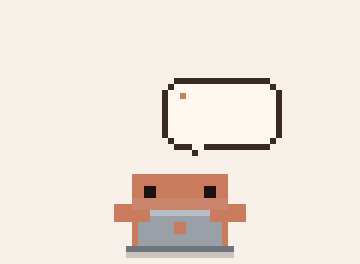

# Pixel Claude Desktop Pet

A tiny, orange, pixel-art buddy who lives along the bottom of your screen on
[Omarchy](https://omarchy.org) / Hyprland. He keeps himself busy: typing away,
hauling crates, sweeping, reading, sipping coffee, dancing, napping, and
now and then thinking fondly about Omarchy. If you use
[Claude Code](https://claude.com/claude-code), he loosely follows what Claude is
doing, too.



> An unofficial fan project. Not made by, affiliated with, or endorsed by Anthropic.
> "Claude" is a trademark of Anthropic.

## What he does

- **Keeps busy on his own.** He wanders, types on his laptop, carries crates, sweeps
  up, reads, takes coffee breaks, dances and naps (more often late at night).
  He also does four acts from Claude's own mascot clips: exploring (leaning to look
  around, then leaping across the floor), waving a flag, stomping and throwing
  confetti, and a gym session with a sweatband and dumbbell curls. Sometimes he
  just sways and smiles, looking happy and content.
  And now and then he pulls a laptop out of thin air, sets it on the floor and
  types away side-on.
  He blows bubbles from a little wand, each one drifting up and popping, and
  sometimes heads off on a hike with a bedroll strapped on and a hiking pole.
  He also has a sparkler: he holds it up fizzing, points it out, waves it
  overhead in glowing arcs and writes a heart in the air.
  Now and then he hops and waves at a thought bubble holding the Omarchy icon or
  the OMARCHY wordmark, in colors from Omarchy themes (including your current one).
- **Grooves to your music.** When something is playing on your computer (any app's
  audio, not calls), he puts on blue headphones and either dances side to side
  with his eyes shut or spins a DJ set behind a little deck, nodding to the beat
  as the buttons light up. Detected with `pactl`; he takes them off when it stops.
- **Loves attention.** Left-click to pet him: he hops, basks in hearts, then
  takes a calm moment (or waves a big red heart back at you). Drag him anywhere and he drops back to the floor.
- **Follows Claude Code, loosely.** While Claude is editing he types, while it's
  reading or searching he reads, and while it runs commands he types or hauls
  crates. When Claude is thinking, he thinks. When it finishes, he celebrates
  (sometimes with a confetti stomp). If it needs your permission or an answer, he
  waves at you, or waves a flag, with a question mark. When it's asking to run a
  terminal command, a terminal pops up over his head and he bounces excitedly.
  When Claude makes its first move on your prompt, a lightbulb flickers over his
  head; when a command fails, he's knocked flat with ERROR flashing overhead.
  A permission prompt startles him first (a "!" pops up). While Claude searches
  he looks up, to the side and down. When it finishes he might throw his hands
  in the air or twinkle with blue sparkles, and if your prompt thanks Claude,
  three little hearts float up. New sessions sometimes get a wink. He still
  takes the odd break, so he's never a strict mirror.
- **Watches your battery.** After a nap, or when you come back from a break, a
  battery pops up over his head showing your computer's real charge (with the
  percentage, and a bolt while charging). It also pops up when the battery drops
  through 50%, 20%, 10% and 5%, when you plug in, and when it's full. He hops when
  it's charged, looks worried at 20%, and droops at 10%. (No battery? It just
  fills to full.)
- **Reminds you to get outside.** After about an hour of nonstop computer use, he
  sometimes daydreams about trees, mountain trails or birdwatching.
- **Celebrates the seasons.** Every so often he does something for the time of
  year, and more often around holidays:

  | When | What he does |
  |---|---|
  | Spring | Waters a sprout until it blooms |
  | Summer | Puts on sunglasses and eats an ice cream cone |
  | Fall | Jumps into a pile of leaves |
  | Winter | Builds a snowman while it snows |
  | Valentine's Day (Feb 10–14) | Hugs a big beating heart |
  | St. Patrick's Day (Mar 14–17) | Dances a jig in a green top hat |
  | Easter (the few days around it) | Bunny-hops in bunny ears and finds an egg |
  | Howard Vollum's birthday (May 31) | In a party hat, twiddles the knobs of an old Tektronix-style oscilloscope until the trace locks |
  | July 4th (Jul 1–5) | Waves a sparkler while fireworks go off |
  | Halloween (Oct 24–31) | Wears a sheet-ghost costume or shows off a jack-o'-lantern |
  | Thanksgiving (the few days around it) | Eats a pumpkin pie, bite by bite |
  | Christmas (Dec 18–26) | Wears a Santa hat and holds a present while it snows |
  | New Year's (Dec 31–Jan 2) | Wears a party hat and watches fireworks |

## Install

You need Hyprland (Omarchy has it), Python 3 with PyGObject, GTK 4,
gtk4-layer-shell and jq. On Arch/Omarchy the installer offers to install any that
are missing.

```bash
git clone https://github.com/jos-jason/pixel-claude-desktop-pet.git
cd pixel-claude-desktop-pet
./install.sh
```

The installer copies the app to `~/.local/share/pixel-claude` and adds a
`pixel-claude` command and an app-launcher entry. It also asks before each of these
optional steps:

- **Super + Alt + C** to show and hide him. It's added to `~/.config/hypr/bindings.lua`
  (or `bindings.conf` on older setups), skipped if the key is already taken, and the
  original file is backed up.
- **Claude Code hooks**, so he can follow along. They're merged into
  `~/.claude/settings.json` without touching your other settings, and the file is
  backed up first. New Claude Code sessions pick them up.

Use `./install.sh --yes` to accept everything. To update later, `git pull` and run
`./install.sh` again.

## Using him

- **Show / hide:** press Super + Alt + C, pick *Pixel Claude* in the app launcher,
  or run `pixel-claude`. Launching him again while he's out makes him wave goodbye.
- **Pet:** left-click.
- **Carry:** drag him around and let go.
- **Menu:** right-click to ask for a specific activity, including
  *Celebrate the season*.
- **Start on login:** on Omarchy, add `o.launch_on_start("pixel-claude")` to
  `~/.config/hypr/autostart.lua`.
- **Preview another date's festivities:** `PIXEL_CLAUDE_DATE=2026-12-25 pixel-claude`.

## How the Claude Code connection works

The hooks run `claude-hook`, a tiny script that writes one small status file per
Claude Code session to `$XDG_RUNTIME_DIR/pixel-claude/`. The status is one of
`thinking`, `working` (plus the tool name, like `Edit` or `Bash`), `waiting`, or
`done`. He checks that folder twice a second. The hooks run asynchronously, so
they never slow Claude down, and nothing leaves your computer: no prompts, code
or file contents are recorded.

## Customizing

Everything lives in one file, `pixel-claude.py`, drawn with plain colored
rectangles. Good places to start:

- `ACTIVITIES` sets how often he does each thing and for how long.
- `WORK_FOR_TOOL` and `BREAKS` control how he reacts to Claude Code.
- `occasions()` sets the seasonal and holiday dates. The seasons assume the
  Northern Hemisphere and the holidays are US-centric, so add your own.
- `SPRITES` and `GLYPHS` hold the pixel art as little text grids.

## Uninstall

```bash
./uninstall.sh
```

This removes the app, the keybinding and the Claude Code hooks (backing up the
files it edits).

## License

[MIT](LICENSE)

The explore, flag, confetti and gym acts follow the timings in Ayotomiwa
Wale-Durojaye's frame-by-frame breakdown,
[Reverse-Engineering Claude AI's Mascot Animations with SVG and GSAP](https://tympanus.net/codrops/2026/05/05/reverse-engineering-claude-ais-mascot-animations-with-svg-and-gsap/)
(Codrops), redrawn here at this pet's pixel scale.
